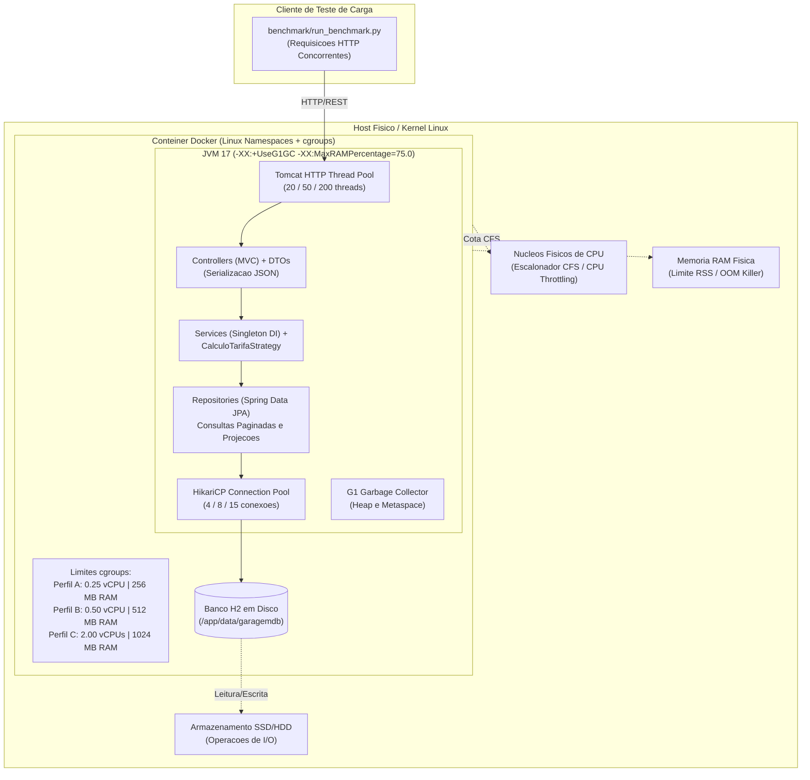

# Sistema de Gerenciamento de Garagem de Veiculos — Analise de Questoes de Hardware no Projeto de Software

**Disciplina:** Arquitetura de Software (ESW430) — Faculdade de Engenharia de Software (UniRV)  
**Professor:** Esp. Elielton de Souza Silva Monteiro  
**Tema:** 10 — Questoes de hardware no projeto de software  
**Integrante:** Wislei Dantas da Silva Costa  

---

## 1. Objetivo

Avaliar empiricamente como as restricoes fisicas de processamento (CPU), hierarquia de memoria (RAM e *Heap* da JVM) e entrada/saida (I/O de armazenamento e *pool* de conexoes) impactam o tempo de resposta, a vazao e a estabilidade de uma aplicacao corporativa conteinerizada.

Este repositorio implementa a etapa tecnica do Trabalho N3, aplicando os conceitos desenvolvidos na fundamentacao teorica em um **Sistema de Gerenciamento de Garagem de Veiculos** construido em **Java 17 com Spring Boot**, executado em conteineres **Docker** sob tres perfis distintos de limitacao de recursos via *Linux cgroups*.

---

## 2. Arquitetura Adotada e Qualidade Estrutural

A aplicacao segue o padrao arquitetural **Model-View-Controller (MVC)** em camadas, associado ao padrao **Repository**, aos principios **SOLID**, a **Injecao de Dependencia (DI)** e a padroes de projeto voltados a eficiencia computacional:

* **Camada Web / Apresentacao (`controller` e `dto`):**
  * `VeiculoController`, `MovimentacaoController` e `HardwareTelemetryController` recebem requisicoes HTTP REST, validam dados de entrada antes de acionar a camada de negocio e trafegam exclusivamente **Data Transfer Objects (DTOs)** imutaveis (`Java records`).
  * O uso de DTOs enxutos evita a serializacao JSON de grafos profundos de entidades ORM, reduzindo o consumo de ciclos de CPU (*carga CPU-bound*) e a alocacao de objetos temporarios no *Heap*.
* **Camada de Servico e Regras de Negocio (`service`, `service.impl`, `service.strategy`):**
  * `VeiculoServiceImpl` e `MovimentacaoServiceImpl` sao componentes *stateless* gerenciados em **escopo Singleton** pelo conteiner Spring IoC, eliminando reinstanciacoes repetidas por requisicao e preservando memoria RAM.
  * Aplicacao explicita dos principios **SOLID**:
    * **SRP (Responsabilidade Unica):** Separacao entre controladores HTTP, servicos de negocio, mapeadores (`VeiculoMapper`, `MovimentacaoMapper`) e telemetria de hardware (`HardwareTelemetryService`).
    * **OCP (Aberto/Fechado) e LSP (Substituicao de Liskov):** Calculo de tarifas de permanencia desacoplado pela interface `CalculoTarifaStrategy` (`TarifaMotoStrategy`, `TarifaPasseioStrategy`, `TarifaUtilitarioStrategy`), permitindo extensao de regras sem alteracao dos servicos existentes.
    * **ISP (Segregacao de Interfaces):** Segregacao das operacoes de veiculos em `VeiculoConsultaService` (leitura paginada) e `VeiculoComandoService` (escrita).
    * **DIP (Inversao de Dependencia):** Controladores e servicos dependem exclusivamente de interfaces injetadas via construtor.
* **Camada de Persistencia (`repository`):**
  * `VeiculoRepository` e `MovimentacaoRepository` encapsulam o acesso ao banco de dados via Spring Data JPA e *pool* de conexoes **HikariCP**.
  * Todas as listagens utilizam **paginacao na origem (`Pageable`)** e **projecoes diretas em DTO (`@Query SELECT new ...`)**, prevenindo o problema de consultas *N+1*, reduzindo trafego de I/O e impedindo o carregamento integral de tabelas na memoria RAM.
* **Carga Inicial Automatica (`DataInitializer`):**
  * Na inicializacao, o sistema popula automaticamente **1.200 veiculos** e **1.200 movimentacoes** em banco persistido em disco (`/app/data/garagemdb`), garantindo volume de dados suficiente para exercitar paginacao, serializacao JSON, *Garbage Collection* e concorrencia no *pool* HikariCP.

---

## 3. Diagramas Arquiteturais

### 3.1 Diagrama de Implantacao e Interacao Software-Hardware (Docker cgroups)



### 3.2 Diagrama de Classes (Camadas MVC, SOLID e Strategy)

```mermaid
classDiagram
    class VeiculoController {
        -VeiculoConsultaService consultaService
        -VeiculoComandoService comandoService
        +listar(TipoVeiculo, Pageable) ResponseEntity
        +buscarPorId(Long) ResponseEntity
        +cadastrar(VeiculoRequestDTO) ResponseEntity
    }

    class MovimentacaoController {
        -MovimentacaoService movimentacaoService
        +listarHistorico(Pageable) ResponseEntity
        +registrarEntrada(EntradaRequestDTO) ResponseEntity
        +registrarSaida(String) ResponseEntity
    }

    class VeiculoConsultaService {
        <<interface>>
        +listarPaginado(TipoVeiculo, Pageable) Page~VeiculoResponseDTO~
        +buscarPorId(Long) VeiculoResponseDTO
    }

    class VeiculoComandoService {
        <<interface>>
        +cadastrar(VeiculoRequestDTO) VeiculoResponseDTO
    }

    class VeiculoServiceImpl {
        -VeiculoRepository veiculoRepository
        -VeiculoMapper veiculoMapper
    }

    class MovimentacaoService {
        <<interface>>
        +registrarEntrada(EntradaRequestDTO) MovimentacaoResponseDTO
        +registrarSaida(String) MovimentacaoResponseDTO
        +listarHistorico(Pageable) Page~MovimentacaoResponseDTO~
    }

    class MovimentacaoServiceImpl {
        -MovimentacaoRepository movimentacaoRepository
        -VeiculoRepository veiculoRepository
        -List~CalculoTarifaStrategy~ estrategiasTarifa
    }

    class CalculoTarifaStrategy {
        <<interface>>
        +suporta(TipoVeiculo) boolean
        +calcular(Duration) BigDecimal
    }

    class VeiculoRepository {
        <<interface>>
        +findByPlacaIgnoreCase(String) Optional~Veiculo~
        +findByTipo(TipoVeiculo, Pageable) Page~Veiculo~
    }

    class MovimentacaoRepository {
        <<interface>>
        +countByStatus(StatusMovimentacao) long
        +findAllProjected(Pageable) Page~MovimentacaoResponseDTO~
    }

    VeiculoController --> VeiculoConsultaService
    VeiculoController --> VeiculoComandoService
    VeiculoServiceImpl ..|> VeiculoConsultaService
    VeiculoServiceImpl ..|> VeiculoComandoService
    VeiculoServiceImpl --> VeiculoRepository

    MovimentacaoController --> MovimentacaoService
    MovimentacaoServiceImpl ..|> MovimentacaoService
    MovimentacaoServiceImpl --> MovimentacaoRepository
    MovimentacaoServiceImpl --> VeiculoRepository
    MovimentacaoServiceImpl --> CalculoTarifaStrategy
```



*(O codigo-fonte PlantUML do diagrama de implantacao tambem encontra-se disponivel em `docs/diagrama_implantacao_hardware.puml`.)*

---

## 4. Passos para Executar

### Pre-requisitos
* **Docker** instalado e em execucao (`docker --version`).
* **Python 3.8+** instalado (`python3 --version`) para execucao do *benchmark* automatizado (utiliza apenas bibliotecas padrao do Python, sem necessidade de `pip install`).
* Porta `8080` livre na maquina hospedeira.

### Passo 1: Construir a imagem Docker da aplicacao
Na raiz do repositorio, execute:

```bash
docker build -t garagem-veiculos-n3:latest .
```

### Passo 2: Executar o Benchmark Automatizado nos 3 Perfis de Hardware
O script `benchmark/run_benchmark.py` instancia sequencialmente o conteiner nos **Perfis A, B e C**, mede o tempo de inicializacao (*startup*), executa aquecimento da JVM (*warm-up*), dispara **400 requisicoes concorrentes (16 *threads* simultaneas)**, coleta telemetria interna da JVM (`/api/sistema/recursos`) e estatisticas de *throttling* do *cgroups*, gerando automaticamente a tabela comparativa em `benchmark/resultados_benchmark.md`:

```bash
python3 benchmark/run_benchmark.py
```

### Execucao Manual Individual por Perfil (Opcional)
Caso deseje subir manualmente cada perfil e consultar os endpoints via navegador, `curl` ou Postman:

* **Perfil A (`0.25 vCPU` / `256 MB RAM` / Pool HikariCP = `4`):**
  ```bash
  docker run -d --name garagem-perfil-a -p 8080:8080     --cpus="0.25" --memory="256m" --memory-swap="256m"     -e DB_POOL_SIZE=4 -e TOMCAT_MAX_THREADS=20     -e JAVA_TOOL_OPTIONS="-XX:+UseG1GC -XX:MaxRAMPercentage=75.0"     garagem-veiculos-n3:latest
  ```

* **Perfil B (`0.50 vCPU` / `512 MB RAM` / Pool HikariCP = `8`):**
  ```bash
  docker run -d --name garagem-perfil-b -p 8080:8080     --cpus="0.50" --memory="512m" --memory-swap="512m"     -e DB_POOL_SIZE=8 -e TOMCAT_MAX_THREADS=50     -e JAVA_TOOL_OPTIONS="-XX:+UseG1GC -XX:MaxRAMPercentage=75.0"     garagem-veiculos-n3:latest
  ```

* **Perfil C (`2.00 vCPUs` / `1024 MB RAM` / Pool HikariCP = `15`):**
  ```bash
  docker run -d --name garagem-perfil-c -p 8080:8080     --cpus="2.00" --memory="1024m" --memory-swap="1024m"     -e DB_POOL_SIZE=15 -e TOMCAT_MAX_THREADS=200     -e JAVA_TOOL_OPTIONS="-XX:+UseG1GC -XX:MaxRAMPercentage=75.0"     garagem-veiculos-n3:latest
  ```

#### Principais Endpoints Disponiveis
* `GET http://localhost:8080/api/sistema/recursos` — Telemetria da JVM, nucleos visiveis pelo *cgroups*, uso de *Heap*/*Non-Heap* e metricas de *Garbage Collection*.
* `GET http://localhost:8080/api/veiculos?page=0&size=20` — Listagem paginada de veiculos.
* `POST http://localhost:8080/api/veiculos` — Cadastro de novo veiculo (`{"placa":"ABC1D23","modelo":"Onix","marca":"Chevrolet","cor":"Prata","tipo":"PASSEIO"}`).
* `GET http://localhost:8080/api/movimentacoes?page=0&size=20` — Historico paginado de movimentacoes.
* `POST http://localhost:8080/api/movimentacoes/entrada` — Registro de entrada (`{"placa":"GOA0001"}`).
* `POST http://localhost:8080/api/movimentacoes/saida/GOA0001` — Registro de saida e calculo de tarifa.

---

## 5. Analise dos Resultados e Validacao das Hipoteses Teoricas

A execucao comparativa entre os tres perfis valida empiricamente os mecanismos descritos na parte teorica do trabalho:

1. **Impacto do Escalonador CFS e *CPU Throttling* (Perfil A vs. Perfis B e C):**
   * No **Perfil A (`0.25 vCPU`)**, o escalonador *Completely Fair Scheduler* (CFS) do Linux limita o conteiner a `25 ms` de processamento acumulado a cada janela de `100 ms`. Durante a inicializacao do Spring Boot (varredura de *classpath* e criacao dos *beans*) e sob carga concorrente de serializacao JSON, multiplas *threads* consomem rapidamente a cota da janela, fazendo com que o kernel suspenda o conteiner ate o proximo ciclo. Isso eleva expressivamente o tempo de *startup* e as latencias de cauda (**p95** e **p99**).
   * Nos **Perfis B (`0.50 vCPU`)** e **C (`2.00 vCPUs`)**, a ampliacao da cota CFS e o acesso a multiplos nucleos permitem que a compilacao JIT (*Just-In-Time*) e o tratamento de requisicoes ocorram em paralelo, reduzindo drasticamente o *CPU throttling* e elevando a vazao (`req/s`).
2. **Hierarquia de Memoria, *Heap* da JVM e Coleta de Lixo (`-XX:MaxRAMPercentage=75.0`):**
   * No **Perfil A (`256 MB RAM`)**, a configuracao `MaxRAMPercentage=75.0` reserva aproximadamente `192 MB` para o *Heap* e apenas `64 MB` para areas nativas fora do *Heap* (*Metaspace*, pilhas de *threads* e *Code Cache* do JIT). Sob carga continua, a proximidade do teto de memoria intensifica a frequencia de coletas do **G1GC**. Como o coletor de lixo disputa ciclos de CPU dentro da mesma cota restrita de `0.25 vCPU`, observa-se o efeito de retroalimentacao previsto na fundamentacao teorica: o GC consome cota de CPU, agravando o *throttling* das *threads* HTTP.
   * Nos **Perfis B (`512 MB`)** e **C (`1024 MB`)**, a folga no *Heap* e nas areas nativas espaca os ciclos de coleta e evita pausas prolongadas.
3. **Efeito Mitigador dos Padroes Arquiteturais Aplicados:**
   * O uso de **DTOs** nas respostas REST e **projecoes JPQL** no `MovimentacaoRepository` evita a instanciacao de grafos completos de entidades, mantendo o consumo de *Heap* controlado mesmo no Perfil A.
   * O **escopo Singleton** dos servicos (`VeiculoServiceImpl`, `MovimentacaoServiceImpl`) e estrategias (`CalculoTarifaStrategy`) impede alocacoes repetidas por requisicao.
   * O dimensionamento proporcional do **pool HikariCP** (`4`, `8` e `15` conexoes) evita que *threads* adicionais disputem CPU apenas para gerenciar sessoes de banco ociosas em ambientes com poucos nucleos.

---

## 6. Integrantes do Grupo

* **Wislei Dantas da Silva Costa:** Arquitetura e implementacao do sistema em Java/Spring Boot (camadas MVC, DTOs, Repositories, Services, estrategias SOLID e telemetria), configuracao do `Dockerfile` e parametrizacao de *cgroups*, desenvolvimento do script automatizado de *benchmark* (`benchmark/run_benchmark.py`), elaboracao dos diagramas e redacao da documentacao tecnica.

---

## 7. Ferramentas de IA Utilizadas

Em conformidade com as normas da disciplina, declara-se que as ferramentas de Inteligencia Artificial **Google Gemini** e **Anthropic Claude** foram utilizadas como apoio na revisao da estrutura arquitetural, geracao e refinamento de trechos de codigo-fonte Java/Spring Boot e Python, bem como na organizacao da documentacao tecnica e dos diagramas Mermaid/PlantUML. Todo o codigo, os parametros de execucao e as analises foram revisados, testados e validados sob responsabilidade integral do autor.
